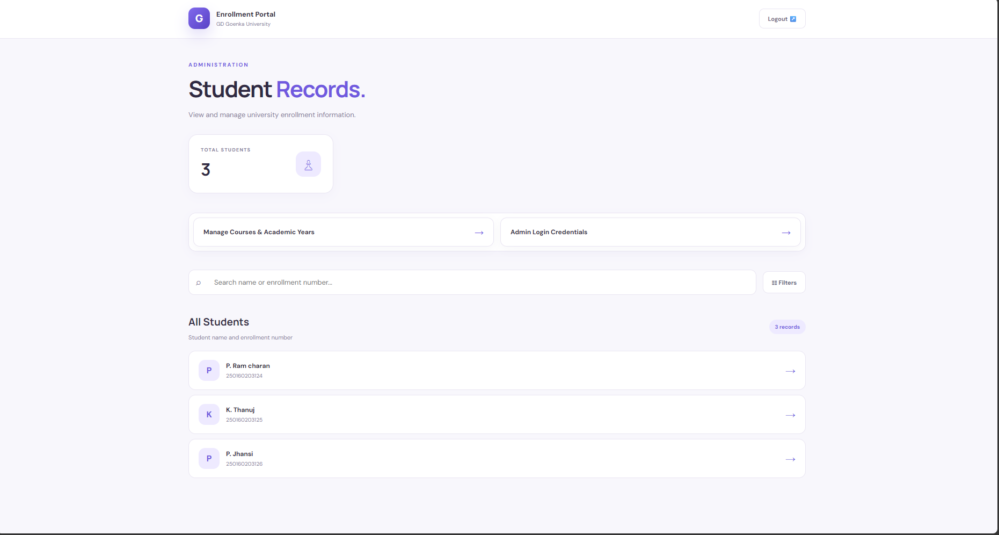

# Enrollment Number Generator

A web-based student enrollment portal built using HTML, CSS and JavaScript.

## Live Demo

[Visit the Website](https://p-ramcharan.github.io/Enrollment_Number_Generator_Website/)

## Features

- Student registration
- Automatic enrollment number generation
- Enrollment number retrieval
- Administrator login interface
- Student record management
- Course and academic year configuration
- Search and filter student records
- Responsive user interface

## Technologies Used

- HTML5
- CSS3
- JavaScript
- Git
- GitHub
- GitHub Pages

## Project Structure

Enrollment_Number_Generator_Website/
|
|-- index.html
|-- style.css
|-- script.js
|-- README.md

## How to Run Locally

1. Clone this repository.
2. Open the project folder in VS Code.
3. Open index.html using Live Server.
4. Explore the enrollment portal.

## Important Notice

This project is an educational demonstration.
It is not an official university enrollment system.
Student data is stored locally in the browser.
Do not enter real personal information.

## Future Improvements

- Secure server-side authentication
- Database integration
- Unique enrollment number generation across users
- Improved data security

## Screenshots

### Homepage

### Student Registration

### Admin Dashboard

## Developer

P. Ram Charan

GitHub: https://github.com/P-RAMCHARAN
